# Wiring

<!-- generated by docs/wiring/wiring.py: edit the plan there, then run it -->

Only power and one ribbon cross an axis. The USB cable comes up the hollow polar axis to the fork, and an 11-wire Dupont ribbon (8 step lines, 2 GND, 5 V) runs from the fork through the hollow left Dec stub into the head. Drawn by `docs/wiring/wiring.py`, which holds the pin plan: change it there, run it, and `--check` checks the plan.

A page with the same content that opens from Finder: [wiring.html](wiring.html).

## Overview

## The GPIO header

## Pin table

On the Pi's header (fill in the wire colours as you go):

| Pin | Pi name | Signal | Goes to | Via | Colour |
|---|---|---|---|---|---|
| 1 | 3V3 | IMU power | BMI160 VIN | head |  |
| 2 | 5V | 5 V in | Y splice 5 V | ribbon, own housing |  |
| 3 | GPIO2 | SDA | BMI160 SDA | head |  |
| 4 | 5V | servo 5 V | SG90 red | head |  |
| 5 | GPIO3 | SCL | BMI160 SCL | head |  |
| 9 | GND | IMU GND | BMI160 GND | head |  |
| 12 | GPIO18 | servo signal | SG90 orange | head |  |
| 14 | GND | servo GND | SG90 brown | head |  |
| 31 | GPIO6 | RA IN1 | RA ULN2003 IN1 | ribbon |  |
| 32 | GPIO12 | RA IN2 | RA ULN2003 IN2 | ribbon |  |
| 33 | GPIO13 | RA IN3 | RA ULN2003 IN3 | ribbon |  |
| 34 | GND | GND | Y splice GND | ribbon |  |
| 35 | GPIO19 | RA IN4 | RA ULN2003 IN4 | ribbon |  |
| 36 | GPIO16 | Dec IN1 | Dec ULN2003 IN1 | ribbon |  |
| 37 | GPIO26 | Dec IN2 | Dec ULN2003 IN2 | ribbon |  |
| 38 | GPIO20 | Dec IN3 | Dec ULN2003 IN3 | ribbon |  |
| 39 | GND | GND | Y splice GND | ribbon |  |
| 40 | GPIO21 | Dec IN4 | Dec ULN2003 IN4 | ribbon |  |

Not on the header:

| From | To | Via |
|---|---|---|
| USB cable 5 V (red) | Y splice 5 V | up the hollow column (Ø15) |
| USB cable GND (black) | Y splice GND | up the hollow column |
| Y splice 5 V | RA ULN2003 +, Dec ULN2003 + | Dupont F |
| Y splice GND | RA ULN2003 −, Dec ULN2003 − | Dupont F |
| RA 28BYJ-48 | RA ULN2003 motor socket | its own 5-pin cable (keyed) |
| Dec 28BYJ-48 | Dec ULN2003 motor socket | its own 5-pin cable (keyed) |
| Camera v2.1 | Pi CSI connector | flat flex cable, contacts towards the HDMI port |

## Building it

- **The ribbon housing.** 8 step lines and 2 GND in one 2×5 housing on pins **31–40**, flush with the header's USB end. It has no 5 V in it, so a wrong fit can't put 5 V on a GPIO. It still goes on turned round, which puts the GND wires on GPIO12 and GPIO26: mark the pin-31 corner on the housing and the head.
- **5 V in.** On its own red, marked 1-pin housing on pin **2**. Before the first power-up, with the multimeter: 5 V between pin 2 and pin 6 (red probe on 2), and nothing between pin 2 and any ribbon pin.
- **Through the Dec stub.** The stub's bore is Ø12. The 1×4 housings at the fork end fit through it, the 2×5 (about 13.7 mm across the corners) doesn't, so thread the ribbon from the head outwards.
- **The Y splice.** A spare USB-A cable, cut and soldered at the fork: 5 V to both boards' **+** and the ribbon's 5 V, GND to both boards' **−** and the ribbon's two GND wires. Check which wire is 5 V with the meter, cheap cables don't always use red and black. Keep each ULN2003's on/off jumper on.
- **The servo.** 5 V from pin 4, which is the same net as pin 2 (the header's 5 V pins are joined on the board), so it is really the harness wire, split at the header. A stall shows in `vcgencmd get_throttled`; the servo only moves for darks, never during an exposure. Its 3-pin plug doesn't fit pins 4/12/14: three M–F jumpers into the plug.
- **The IMU.** VIN to 3.3 V (pin 1). Leave CS open (I²C mode) and SA0 open; `i2cdetect -y 1` should show 0x68 or 0x69. Tie CS to 3.3 V if nothing shows up.
- **Boot.** The step pins come up as inputs. GPIO0–8 have pull-ups at boot, so GPIO6 (RA IN1) may light RA's first LED until `mountd` starts. Harmless, but `mountd` must begin by driving all eight low.
- **Mark the boards.** Label the ULN2003 boards RA and Dec. The IN order only matters to the step sequence in `mountd`, so a swapped pair shows up as a motor that hums instead of turning.
- **Later.** The IR sky sensor shares I²C, but it sits on the foot, two axes away from the Pi: it needs its own route, not planned yet.
